# aiplo

A browser sketchbook for the AxiDraw pen plotter. Each artwork is a small script with knobs: pick a place, a date, a song or a photo, preview it on paper, export an SVG, or plot it straight to the AxiDraw over WebSerial. There's no server and no Inkscape.

```sh
npm install
npm run dev     # develop at http://localhost:5173
npm run plot    # build and serve on :5180 for plotting (never live-reloads)
```

Plotting needs Chrome or Edge (WebSerial). Everything else works in any modern browser.

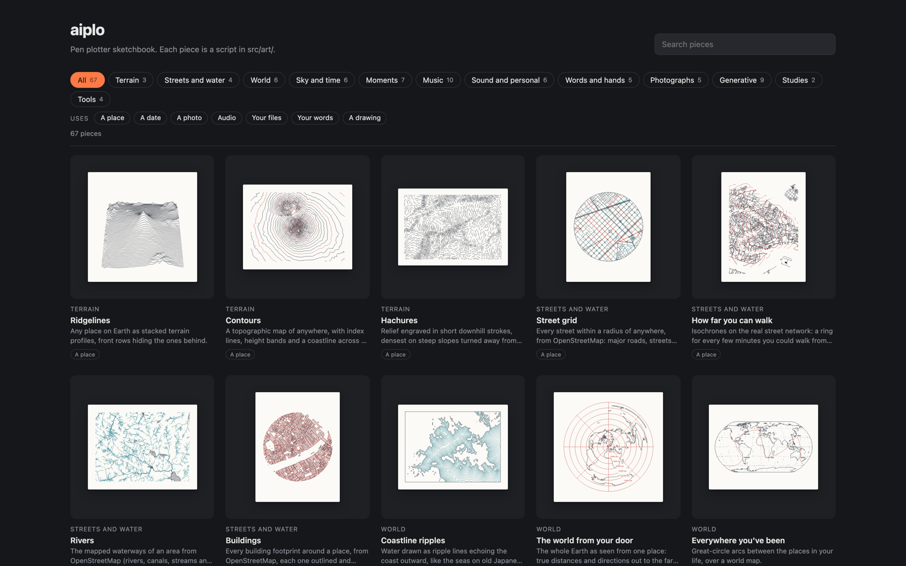

Open a piece to turn its knobs, preview it on paper, and plot it:

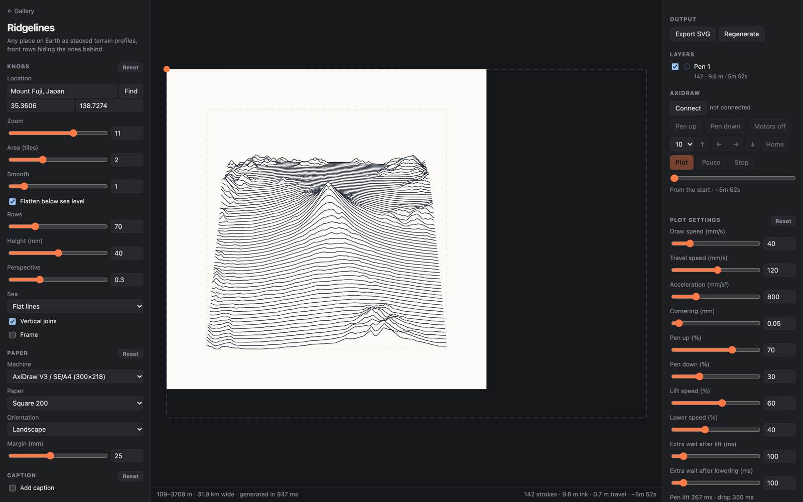

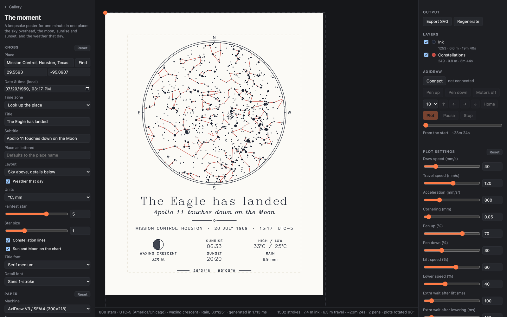

## The gallery

There are 67 pieces, searchable and filterable by series and by what they use (a place, a date, a photo, audio, your words…). Every piece renders something with no input (a default place, a demo image, a public-domain demo song), so you can open anything and start turning knobs. The images below are each piece's defaults.

### Terrain

Ridgelines, Contours, Hachures.

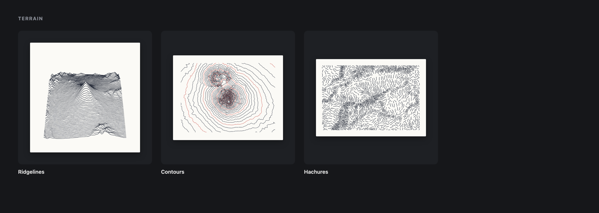

### Streets and water

Street grid, How far you can walk, Rivers, Buildings.

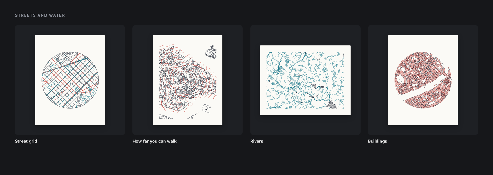

### World

Coastline ripples, The world from your door, Everywhere you've been, Your runs or rides, Engraved terrain, Earthquakes.

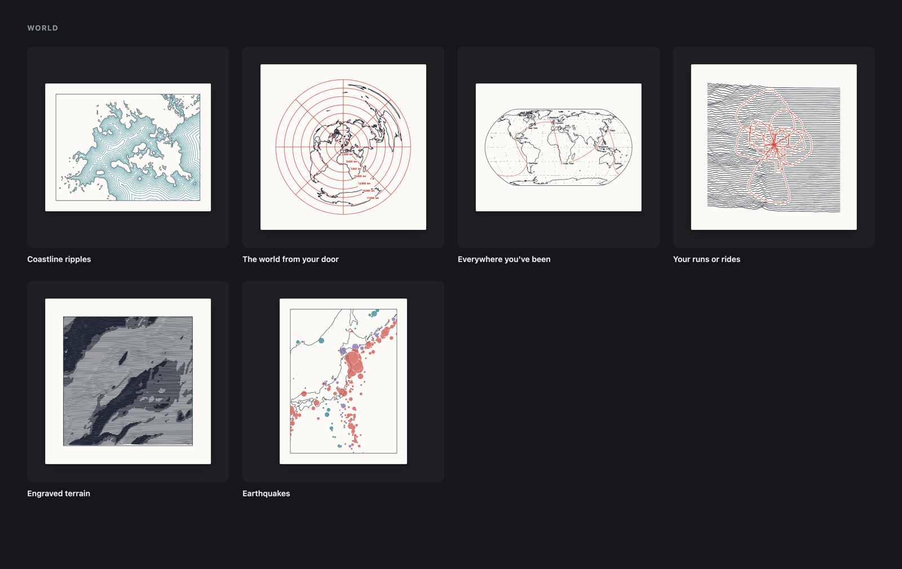

### Sky and time

Star chart, Sun paths, Moon calendar, Wind on a day, A year of weather, Tides.

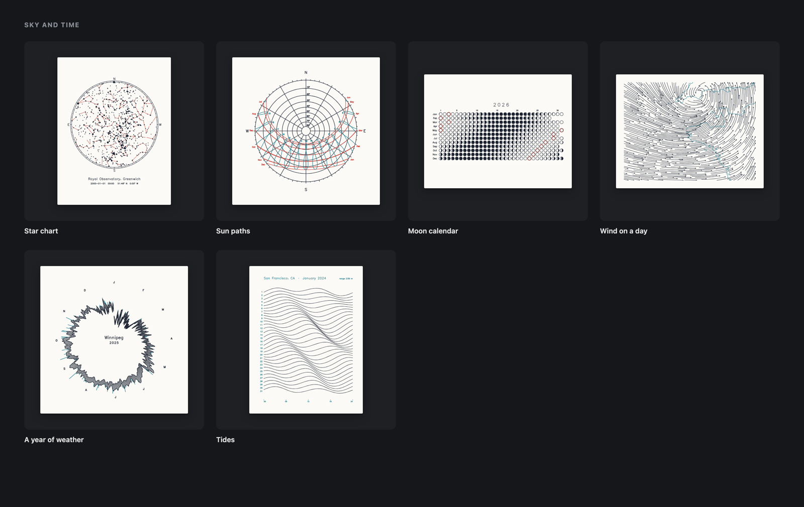

### Moments

The moment, Concert night, Birth poster, Powers of ten, Two hometowns, The route, Where our photos were taken.

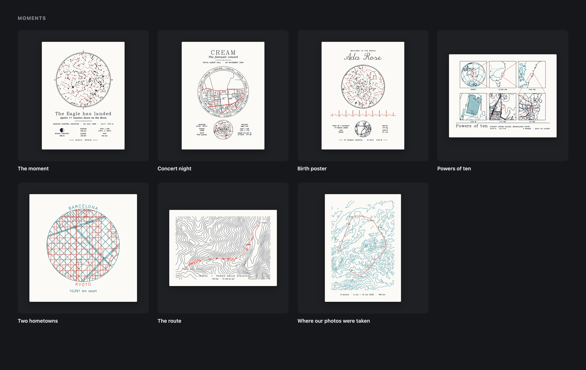

### Music

Lyric ridgelines, The record, Words sized by loudness, The song as a mountain range, Melody line, Rhythm mandala, Chord journey, MIDI spiral, Duet, Your year in music.

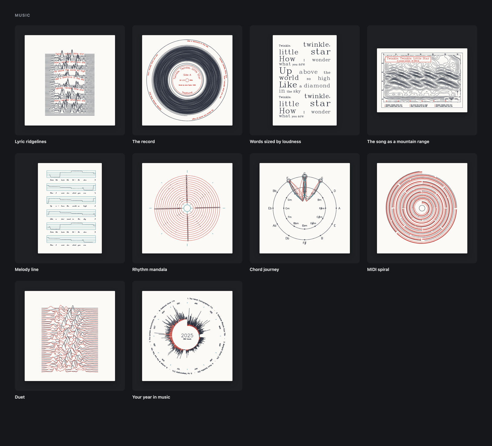

### Sound and personal

Unknown Pleasures from your song, Voice groove, Signature, Heartbeat, GitHub year, A chess game.

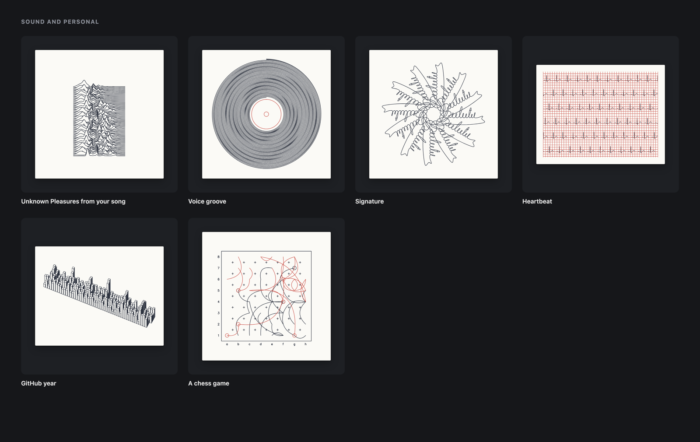

### Words and hands

Handwriting restored, Calligram, Family tree, Life timeline, Fingerprint.

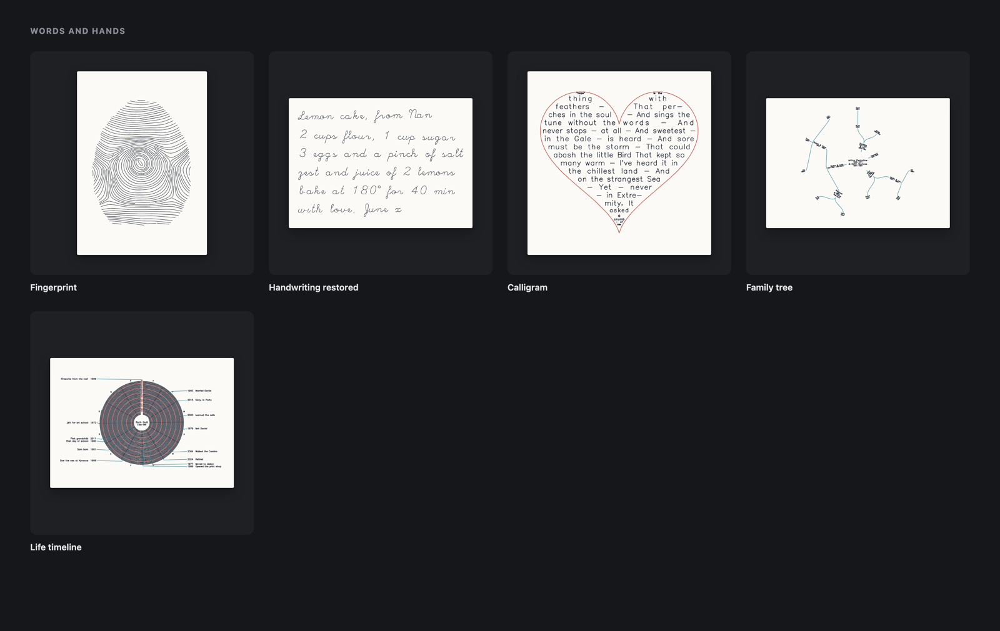

### Photographs

Squiggle portrait, Spiral halftone, One-line drawing, Three-pen photo, Edge flow.

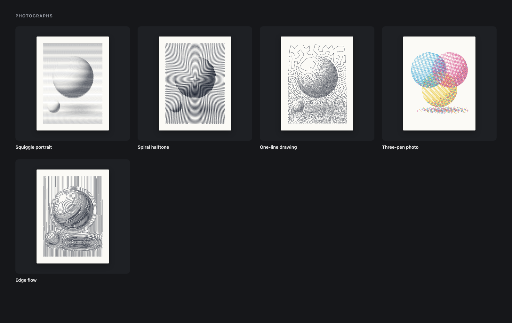

### Generative

Harmonograph, Spirograph, Mazes and Truchet tiles, Space-filling curve, Moiré, Wave interference, Differential growth, Circle packing and Voronoi, A name as a seed.

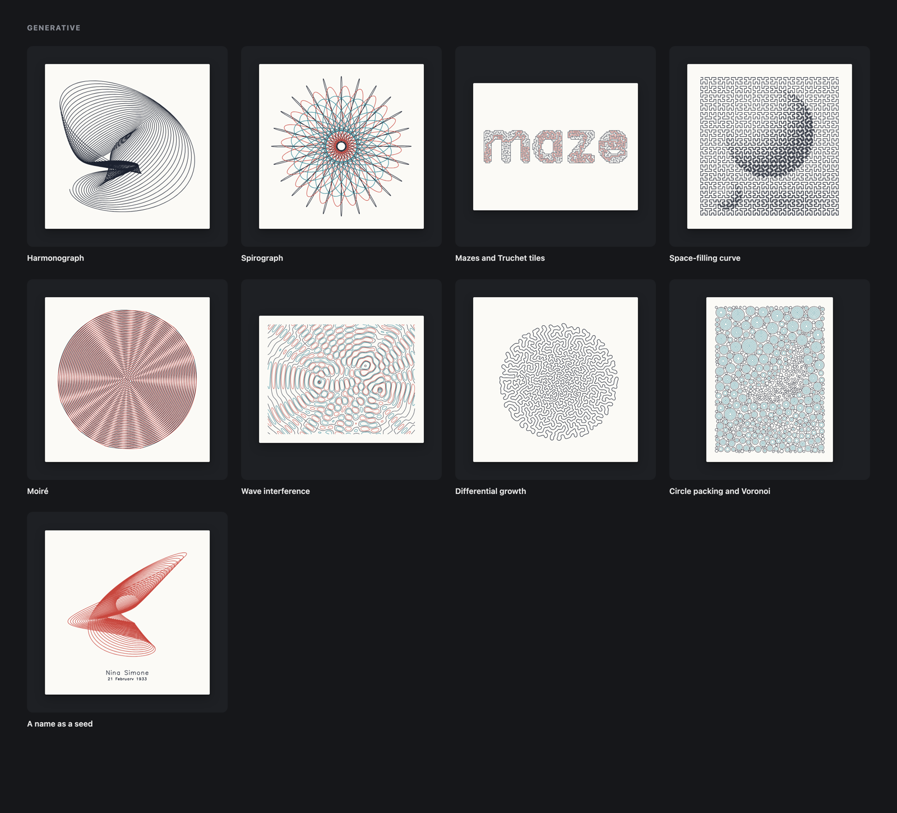

### Studies and tools

Terrain explorer, Flow field; Calibration, Scratchpad, Lettering, and SVG import (plot any SVG).

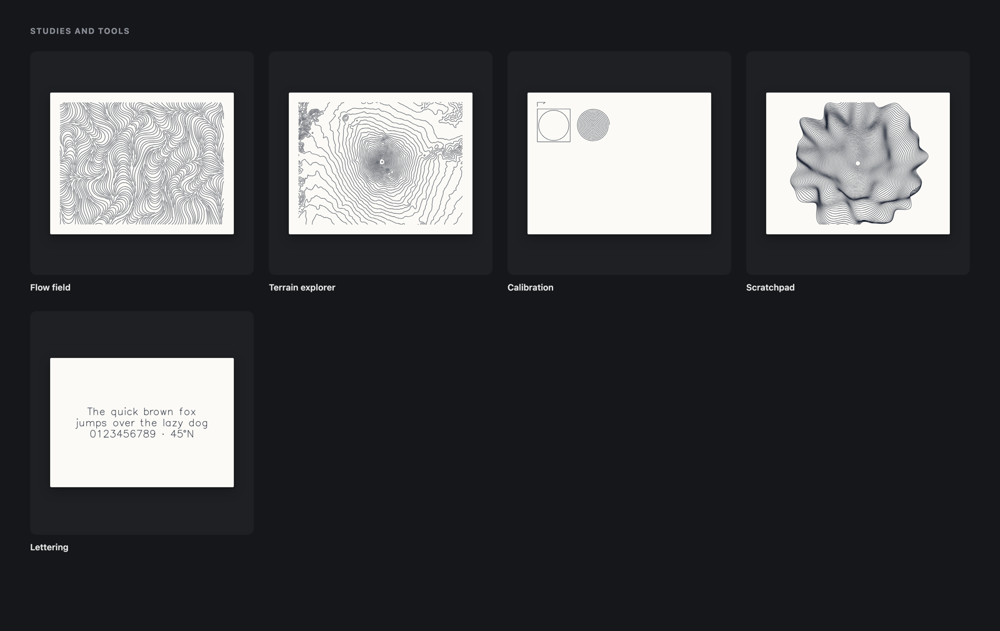

## Plotting

### Setup

1. Plug in **both** the AxiDraw's power supply (it drives the motors) and USB (it carries the commands). With USB alone the board lights up but the motors won't move.
2. Check your model under **Paper → Machine**. Measure how far the carriage travels: about 30 cm is the standard AxiDraw V3 (up to 300 × 218 mm: Letter and A4); about 43 cm is the V3/A3 (up to 430 × 297 mm).
3. Press **Motors off**, push the carriage to the home corner (top-left), and put the paper's top-left corner under the pen.
4. **Connect**, then use **Pen up** / **Pen down** to check the heights. The pen should clear the paper by a few millimetres.
5. Plot **Calibration** first. Its arrow should point right and its square should measure 50 mm.

### While plotting

- **Pens:** each layer is a pen. Layers plot in order, and the carriage returns home and waits for a pen swap in between. Untick a layer to skip it.
- **Timeline:** drag the timeline to start from any point, even mid-line. The preview fades what will be skipped.
- **Pause and stop:** **Pause** lifts the pen (you can swap pens). **Stop** returns home, and the timeline stays where the plot got to, so **Plot** carries on from there.
- **Saved progress:** progress is saved as it plots. After a crash or reload, reopening the piece puts the timeline back where it stopped. Home the carriage, reconnect, then Plot.
- **While editing code:** plot from `npm run plot` while code is changing. The dev server reloads the page when files change, which drops the AxiDraw connection.

### Pen settings

Under **Plot settings**:

- **Pen up / down (%):** the servo positions. Defaults are 70% and 30%.
- **Lift speed / Lower speed:** the app sets the servo's speed itself, and each pen move waits exactly as long as the servo takes plus a short settle. The line under the settings shows the result (e.g. "Pen lift 267 ms · drop 350 ms").
- **Extra wait after lift / lowering:** if travel moves leave short tails, raise *Extra wait after lift* (or lower *Lift speed*). If line starts are faint, raise *Extra wait after lowering*.
- **Speeds and acceleration:** these trade time for line quality. The status bar shows the estimated plot time.

## Captions and checks

- **Caption section:** each piece has one, which letters into the bottom margin. Tokens: `{title}`, `{place}`, `{coords}`, `{date}`, `{edition}`. You can add an edition number (e.g. 3/10) and your signature, which you draw once and every piece shares.
- **Ink density check:** post-processing warns when an area is so dense the ink may bleed or tear the paper. **Show ink density** highlights it.
- **Other post-processing:** hand wobble, simplification, dropping tiny strokes, travel optimisation, and direction-aware gap joining.

## Making a piece

Each artwork is a script in `src/art/`. Copy `src/art/_template.ts` to `src/art/my-piece.ts` and it appears in the gallery.

```ts
export default defineArtwork({
  slug: 'my-piece',
  title: 'My piece',
  description: 'One line for the gallery card.',
  paper: { paper: 'letter', orientation: 'landscape', margin: 15 },
  params: [{ type: 'number', key: 'count', label: 'Count', min: 1, max: 200, default: 40 }],
  generate(v, ctx) {
    // ctx.width / ctx.height: drawing area in mm. Return polylines ([[x, y], ...]),
    // or [{ name, color, paths }] layers for several pens. Can be async.
  },
});
```

- **Knob types:** `number`, `select`, `checkbox`, `seed` (feeds `ctx.rng`), `location` (place search), `places` (a geocoded list), `text`, `date` (optionally with time), `file` (stored in IndexedDB; read with `loadFiles`), `sketchpad` (draw in the browser) and `code`. Each piece remembers its own knob values, paper and caption, and each settings group has a Reset.
- **Defaults must render:** a piece should draw something with no input (demo image, demo song, a default place) so its gallery thumbnail works. Aim for default plots of roughly 3–25 minutes with little or no saturation.
- **Series:** `kind` is `'art'` (default), `'study'` or `'tool'`. Artworks are grouped by `order` range (1–9 Terrain, 10–19 Streets and water, 20–29 World, 30–39 Sky and time, 40–49 Sound and personal, 50–59 Photographs, 60+ Generative) unless they set `series` (e.g. Moments, Music, Words and hands). Gallery badges come from the knobs.
- **DOM access:** pieces that need the DOM (SVG layout, audio decoding) set `mainThread: true`. Everything else runs in a Web Worker.

### Building blocks in `src/lib/`

| File | What it gives you |
|---|---|
| `elevation.ts`, `terrain.ts` | Any place's heightmap (normalised height, metres, sea mask); `ridges`, `contours`, `contourLevels`, `coastline`, `hachures`, `rays`, `rings` |
| `osm.ts` | OpenStreetMap via Overpass (retries, mirror fallback, cache), local projection, circle clipping, parallel strokes |
| `world.ts` | Natural Earth coastlines, world and azimuthal projections with seam handling, great circles, graticules |
| `astro.ts` | Sidereal time, sun and moon positions, moon phase geometry, sky projection |
| `weather.ts` | Open-Meteo archive client |
| `moments.ts`, `moments-geo.ts` | Poster building blocks: star charts, moon glyphs, sunrise/sunset, a day's weather, real historical time zones, globes and map frames |
| `routing.ts`, `gpx.ts`, `exif.ts` | OSRM routes (drive, walk, cycle); GPX parsing; GPS and dates from JPEG EXIF |
| `audio.ts` | Audio decoding (main thread), FFT, spectrograms, envelopes |
| `music.ts`, `music-text.ts` | Pitch tracking, onsets and tempo, chord charts, MIDI read/write; lyric timing and loudness |
| `song.ts`, `lyrics.ts` | A public-domain demo song with timed notes, chords and lyrics; LRC parsing and LRCLIB lookups |
| `image.ts`, `stipple.ts` | Photo knobs, darkness sampling, CMY channels, a demo image; weighted stippling and TSP tours |
| `words-strokes.ts`, `words-shape.ts` | Recovering pen strokes from photos of handwriting; shape masks and spans for text-filled shapes |
| `hatch.ts` | Polygon hatching and tone-by-hatching |
| `hershey.ts` | Single-stroke lettering in 8 Hershey fonts, including text along any path |
| `streamlines.ts` | Evenly spaced streamlines for any vector field |
| `gen-util.ts` | Fitting, clipping to shapes, insetting, stitching segments into long lines |
| `files.ts` | Uploaded files in IndexedDB |

`src/geom.ts` has clipping, simplification, resampling, smoothing and path optimisation. `src/random.ts` has seeded random numbers, simplex noise and `seedFromText`.

## How it fits together

- **Workers:** generation and post-processing run in a Web Worker (`worker.ts`, `engine.ts`), and only the latest pending request is kept. Gallery thumbnails render in a second worker as they scroll into view, and are cached until a piece's knobs change.
- **Plotter:** `src/plotter/` has the EiBotBoard serial driver, a trapezoidal motion planner with junction-deviation cornering, servo speed and timing, and the plot loop.
- **Export:** SVG export writes one Inkscape layer per pen (`1-name`, `2-name`…), which also works with AxiDraw's own software.

## Data and credits

Data comes from free, keyless services, fetched in the browser and cached in memory:

- **Elevation:** [AWS Terrain Tiles](https://registry.opendata.aws/terrain-tiles/) (Mapzen terrarium encoding).
- **Places:** [OpenStreetMap](https://www.openstreetmap.org/copyright) via Overpass (© OpenStreetMap contributors, ODbL); place search via Nominatim.
- **Coastlines:** [Natural Earth](https://www.naturalearthdata.com/) coastlines and borders (public domain).
- **Stars:** star and constellation data from [d3-celestial](https://github.com/ofrohn/d3-celestial).
- **Weather:** [Open-Meteo](https://open-meteo.com/) historical weather and time zones.
- **Earthquakes and tides:** [USGS](https://earthquake.usgs.gov/fdsnws/event/1/) earthquakes and [NOAA](https://tidesandcurrents.noaa.gov/) tide predictions.
- **Routes:** [OSRM](https://project-osrm.org/) routing.
- **Lyrics:** [LRCLIB](https://lrclib.net/) synced lyrics.
- **GitHub contributions:** [github-contributions-api](https://github.com/grubersjoe/github-contributions-api).
- **Fonts:** Hershey fonts (public domain, Dr. A. V. Hershey), JSON from [hersheytext](https://github.com/techninja/hersheytext) (MIT; see `src/lib/fonts/LICENSE-hersheytext`).

Lyrics fetched from LRCLIB stay in your browser for your own prints. Music pieces default to a synthesized public-domain song ("Twinkle, Twinkle, Little Star"), and real song lyrics should never be committed to this repo.

## License

[MIT](LICENSE), © 2026 Charlie Gleason. Third-party data and fonts keep their own licences (see above).
